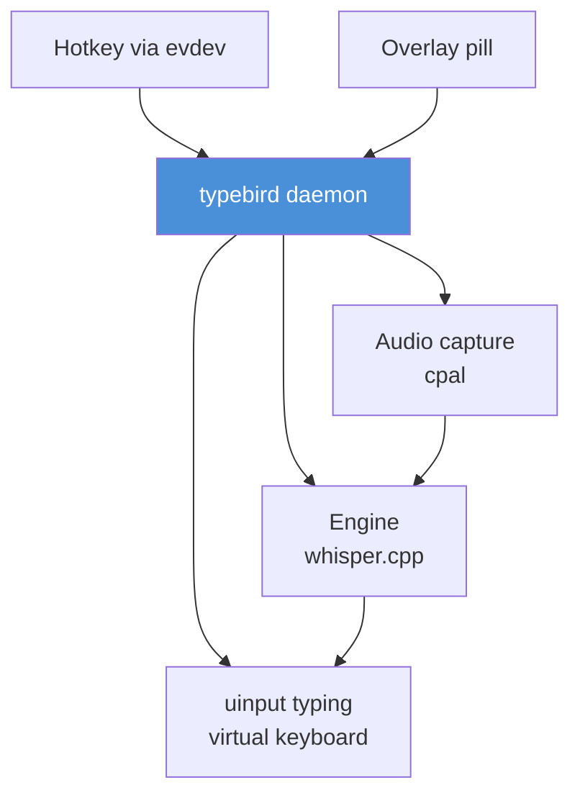

<p align="center">
  
</p>

<h1 align="center">typebird</h1>

<p align="center">
  <a href="https://github.com/Sran012/typebird/actions/workflows/ci.yml"></a>
  <a href="https://github.com/Sran012/typebird/blob/main/LICENSE"></a>
  <a href="https://github.com/Sran012/typebird/stargazers"></a>
  <a href="https://github.com/Sran012/typebird/network/members"></a>
</p>

<p align="center">
  Voice typing for Linux. Press a key, talk, and the words appear as you speak.
</p>

<p align="center">
  Native Rust daemon and a focus-safe overlay. No webview, no cloud, no telemetry.
</p>

<p align="center">
  
  <br>
  <sub>The pill is the only UI. It never takes focus.</sub>
</p>

## Status

v0.1.0. Linux x86_64. The core is there: global hotkey, chunked transcription, uinput typing, overlay pill, installer, doctor. See the roadmap below. The daemon and the pill are small native binaries; the bundled engine is a static build of `whisper-cli`.

## Requirements

- Linux, x86_64, glibc 2.35 or newer (Ubuntu 22.04 or newer, or an equivalent).
- A desktop session with X11 or Wayland. The pill runs under XWayland; a pure Wayland session without XWayland will still type, but the pill will not show.
- An audio device PipeWire, PulseAudio, or ALSA can see.
- About 150 MB of disk for the models.
- `sudo` for the installer: it adds you to the `input` group and installs one udev rule.

## Quick start

```bash
curl -fsSL https://raw.githubusercontent.com/Sran012/typebird/main/install.sh | bash
typebird doctor
```

The installer downloads the latest release, verifies its checksum, installs the binaries and models, adds you to the `input` group, installs the udev rule, and adds typebird to your desktop autostart. **Log out and back in once** so the group applies. Then press **Ctrl+Shift+D**, talk, and press it again (or click stop). Text goes to the window that had focus.

## How it works



- Audio capture via cpal (PipeWire, PulseAudio, or ALSA, autodetected).
- Transcription via a bundled static build of `whisper-cli` (whisper.cpp), English model by default.
- Typing through a uinput virtual keyboard. Because it is a kernel input device, it works identically on X11 and Wayland.
- Recording is streamed in chunks, so text appears while you speak instead of all at once when you stop.

## Install

### One command

```bash
curl -fsSL https://raw.githubusercontent.com/Sran012/typebird/main/install.sh | bash
```

### From a release tarball

```bash
curl -fsSL https://github.com/Sran012/typebird/releases/latest/download/SHA256SUMS -o SHA256SUMS
curl -fsSL -O https://github.com/Sran012/typebird/releases/latest/download/typebird-v0.1.0-x86_64-unknown-linux-gnu.tar.gz
sha256sum -c SHA256SUMS
tar -xzf typebird-v0.1.0-x86_64-unknown-linux-gnu.tar.gz
cd typebird-v0.1.0-x86_64-unknown-linux-gnu
./install.sh
```

Use the tag name from the release page in the URLs above.

### From source

```bash
git clone https://github.com/Sran012/typebird
cd typebird
./build.sh
cd dist/typebird-v*-x86_64-unknown-linux-gnu
./install.sh
```

`build.sh` builds the Rust binaries, builds the static `whisper-cli`, and packages the same tarball CI ships. You need the system dependencies listed in `CONTRIBUTING.md`.

### Uninstall

```bash
~/.local/share/typebird/uninstall.sh          # keeps the models
~/.local/share/typebird/uninstall.sh --purge   # also removes the models
```

## Usage

```
typebird install         # autostart the daemon and pill with the desktop session
typebird daemon          # run the daemon in the foreground
typebird toggle          # start or stop recording
typebird start           # explicit start
typebird stop            # stop, transcribe, type
typebird cancel          # abandon without transcribing
typebird state           # ready / listening / transcribing
typebird info            # engine, recorder, injector in use
typebird doctor          # what's present, what's missing
typebird models          # list models
typebird hotkey <key>   # optional extra binding for GNOME
typebird type <text>    # type text through the virtual keyboard
```

The daemon listens for **Ctrl+Shift+D** itself through `/dev/input`, so the shortcut works on any desktop without compositor configuration. The pill is a small always-on-top window at the bottom of the screen; it shows the daemon state and has a working stop button. It never takes keyboard focus, so text keeps going to the window you were typing in.

## Design choices

- **uinput instead of xdotool or wtype.** A virtual keyboard is a kernel device, so typing works on X11 and Wayland with the same code, and it does not depend on the compositor's protocol version.
- **evdev hotkey instead of a desktop shortcut.** The daemon reads the key itself, which is why the shortcut works on GNOME, KDE, and minimal window managers without configuration. The trade-off is read access to the keyboard devices.
- **Focus-safe overlay.** The pill is a 1x1 transparent window when idle and only grows while recording. It sets `WM_HINTS.input = False` and never unmaps, so the window manager never hands it the keyboard.
- **Chunked transcription.** Audio is cut into chunks of a few seconds while you speak. Text appears during the recording, not only after you stop.
- **No webview.** The pill is egui over XWayland. The daemon is a plain binary.

## Text injection

By default typebird creates a uinput virtual keyboard. This works on every compositor because it is a kernel input device, not an X11 or Wayland protocol.

The cost: a keyboard emits keycodes, not characters, so characters are mapped through a US-QWERTY layout. On a different layout the keycodes are still valid but the characters differ. typebird reports characters it cannot type rather than typing something else. `wtype`, `ydotool`, and `xdotool` remain available as fallbacks. Reading the active keymap is on the roadmap.

## Streaming

Text appears while you speak, not all at once when you stop. Chunks are cut every few seconds. Pauses never stop recording. Tap stop when you are finished.

Seam-hiding makes chunk boundaries invisible:

- strips ellipses whisper writes at chunk edges
- lowercases mid-sentence restarts
- drops false full stops on short pauses

## Audio capture

Detected, not assumed: PipeWire, then PulseAudio, then ALSA. Recording is 16 kHz mono s16, which is what the engines want. The recorder is stopped cleanly so the last chunk is still transcribed.

## Models

`$XDG_DATA_HOME/typebird/models` (or `~/.local/share/typebird/models`), overridable. Bare model names resolve there; absolute paths are used as given. The installer downloads `ggml-base.en.bin` and the Silero VAD model. Downloading a model once and having every tool use it is the point.

## Troubleshooting

Run `typebird doctor` first. It reports what is present and what is missing.

- **Hotkey does nothing.** You are not in the `input` group, or the udev rule is not loaded. Run `sudo usermod -aG input $USER`, then log out and back in. Check `id -nG | grep input` and `ls -l /dev/input/event*`.
- **Pill does not show.** The pill needs XWayland. Check `echo $DISPLAY`. On a pure Wayland session, install XWayland. The daemon still types without the pill.
- **`whisper-cli` not found.** The bundled binary lives in `~/.local/share/typebird/bin`. Reinstall, or add that directory to your `PATH`.
- **Model not found.** Check the path in `typebird models`. Reinstall or place the model file in the model directory.
- **uinput permission denied.** The udev rule is missing or not reloaded. Reinstall, or run `sudo udevadm control --reload-rules && sudo udevadm trigger`.
- **Nothing is typed.** Test the injection path with `typebird type hello`. If that works but dictation does not, the model or the audio path is the problem.
- **Wrong characters on a non-US layout.** See the text injection section. The mapping is US-QWERTY.
- **Stuck daemon.** `pkill -x typebird; pkill -x typebird-pill; typebird daemon`.

## Security

The hotkey needs read access to your keyboards, and typing needs write access to `/dev/uinput`. Together that is the ability to read every keystroke and synthesize arbitrary ones. That is inherent to a global dictation shortcut, but it is a real capability. The installer adds you to the `input` group and installs a udev rule for `/dev/uinput`. If that is not acceptable, bind a desktop shortcut to `typebird toggle` instead and do not install the hotkey. typebird makes no network requests at runtime; the installer is the only part that talks to the network. See `SECURITY.md`.

## Roadmap

- voice commands (punctuation, newline, corrections)
- built-in model downloader (`typebird models get base.en`)
- configurable hotkey
- reading the active keymap for correct characters on non-US layouts
- streaming transcription improvements

---

## Contributing

Contributions are welcome. See `CONTRIBUTING.md`. For security reports, see `SECURITY.md`. Please open issues using the templates in `.github/ISSUE_TEMPLATE`.

## License

[MIT](LICENSE)

## Star History

[](https://star-history.com/#Sran012/typebird&Date)
