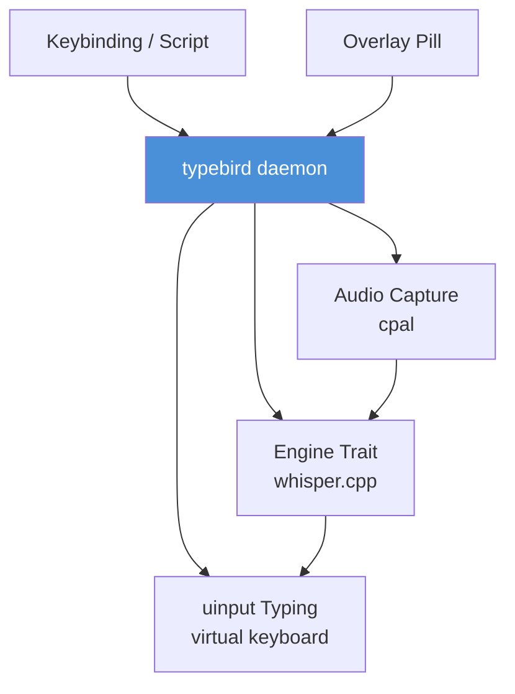

# typebird

[](https://opensource.org/licenses/MIT)
[](https://github.com/Sran012/typebird/stargazers)
[](https://github.com/Sran012/typebird/network/members)

Voice typing for Linux. One binary, one model, every app.

Press a hotkey, talk, text appears in whatever has focus. Works on X11 and Wayland, GNOME and KDE. Single static binary.

## Status

Early. Daemon, streaming, uinput typing, hotkey, overlay pill, doctor, and installer all exist. Roadmap at the bottom.

## Quick start

```bash
curl -fsSL https://raw.githubusercontent.com/Sran012/typebird/main/install.sh | bash
typebird doctor
```

The installer builds the binaries, downloads the model, adds typebird to your desktop autostart, and starts it. A small pill sits at the bottom of the screen with start and stop buttons. Press **Ctrl+Shift+D**, talk, press it again. Text types into whatever window has focus.

## How it works



- Audio capture via cpal (PipeWire / PulseAudio / ALSA, autodetected)
- Transcription via whisper.cpp (`whisper-cli`), English model by default
- Typing via a uinput virtual keyboard. Works identically on X11 and Wayland because it's a kernel input device, not a compositor protocol
- Recording is streamed in chunks. Silence cuts chunks, never stops recording. Text appears while you speak

## Install

See `install.sh`. It detects your distro, installs system deps, builds from source, downloads the model, and adds a desktop autostart entry.

Manual build:

```bash
cargo build --release
cp target/release/typebird ~/.local/bin/
cp target/release/typebird-pill ~/.local/bin/
typebird install        # autostart for the daemon and pill
```

## Usage

```
typebird install         # autostart the daemon and pill with the desktop session
typebird daemon          # run the daemon in the foreground
typebird toggle          # start/stop recording
typebird start           # explicit start
typebird stop            # stop, transcribe, type
typebird cancel          # abandon without transcribing
typebird state           # ready / listening / transcribing
typebird info            # engine, recorder, injector in use
typebird doctor          # what's present, what's missing
typebird models          # list models
typebird models get X    # download model X
typebird hotkey <key>    # optional extra binding for GNOME
```

The daemon listens for **Ctrl+Shift+D** itself through `/dev/input`, so the shortcut works on any desktop without compositor configuration. The pill is a small always-on-top window at the bottom of the screen; it shows the daemon state and has working start and stop buttons. It never takes keyboard focus, so text keeps going to the window you were typing in.

## Text injection

By default typebird creates a uinput virtual keyboard. This works on every compositor because it's a kernel input device, not an X11 or Wayland protocol.

The cost: a keyboard emits keycodes, not characters, so characters are mapped through a US-QWERTY layout. On a different layout the keycodes are still valid but the characters differ. typebird reports characters it cannot type rather than typing something else. `wtype`/`ydotool`/`xdotool` remain available as fallbacks. Reading the active keymap is on the roadmap.

Security note: write access to `/dev/uinput` is the ability to synthesize arbitrary keystrokes. That's inherent to dictation, but it's a real capability. The shipped udev rule scopes it to the active local session via `uaccess` rather than granting it to a group permanently. Skip it with `install.sh --no-udev` and typebird falls back to an external tool.

## Streaming

Text appears while you speak, not all at once when you stop. Chunks are cut at silence points. Pauses never stop recording. Tap stop when finished.

Seam-hiding makes chunk boundaries invisible:
- strips ellipses whisper writes at chunk edges
- lowercases mid-sentence restarts
- drops false full stops on short pauses

## Audio capture

Detected, not assumed: PipeWire, then PulseAudio, then ALSA. Recording is 16 kHz mono s16, which is what the engines want.

The recorder is stopped with SIGINT rather than SIGKILL so it finishes writing a valid WAV header.

## Models

`$XDG_DATA_HOME/typebird/models`, overridable. Bare model names resolve there; absolute paths are used as given. Downloading a model once and having every tool use it is the point.

## Roadmap

- voice commands (punctuation, newline, corrections)
- model downloader that just works (`typebird models get base.en`)
- configurable hotkey
- streaming transcription improvements

---

## Star History

[](https://star-history.com/#Sran012/typebird&Date)

## License

[MIT](LICENSE)